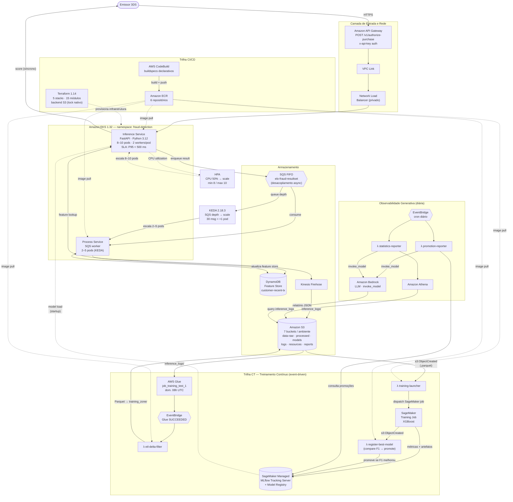
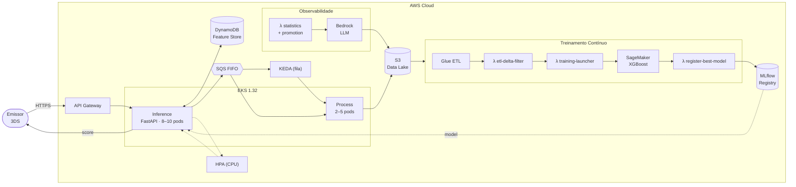

# Diagrama de Arquitetura Atualizado — TCC MLOps

Diagrama completo e corrigido da plataforma.  
Substitui a Figura 1 (Seção 5.2) do artigo atual.  
Gerado em: 2026-06-22 · Revisado em: 2026-09-11 (correção de Terraform 1.11→1.14, remoção do ALB inexistente e inclusão do HPA da Inferência)

---

## Como renderizar e inserir no Word

1. Acesse **https://mermaid.live**
2. Apague o exemplo padrão do editor
3. Cole o código da seção "Código Mermaid" abaixo
4. Clique em **"Download PNG"** (resolução alta) ou **"Download SVG"** (vetorial, preferível)
5. No Word: Insert → Pictures → selecione o arquivo exportado
6. Adicione a legenda: **Figura 1 — Arquitetura da Plataforma MLOps (elaboração do autor)**

> Alternativa: Cole o código em https://mermaid.ink para obter URL direta de imagem.

---

## Código Mermaid — Diagrama Principal

---

## Legenda dos elementos

| Símbolo (Mermaid) | Tipo | Exemplos no diagrama |
|-------------------|------|---------------------|
| `([texto])` | Ator externo | Emissor 3DS |
| `[texto]` | Serviço / componente | API Gateway, Lambda, CodeBuild |
| `[(texto)]` | Banco de dados / storage | DynamoDB, S3, MLflow |
| `{{texto}}` | Evento / gatilho | SQS FIFO, EventBridge |
| `subgraph` | Agrupamento lógico | EKS, CT chain, IaC |
| `-->` | Fluxo síncrono / principal | Requisição, dados |
| `-.->` | Fluxo assíncrono / configuração | Carregamento de modelo, provisionamento |

---

## Descrição detalhada dos fluxos (para legenda no Word)

### Fluxo 1 — Inferência em Tempo Real (síncrono)
O emissor envia a transação 3DS via HTTPS para o **Amazon API Gateway**, que roteia via **VPC Link** e **NLB** (Network Load Balancer, privado) até o **Inference Service** (FastAPI, 8–10 pods via TargetGroupBinding com alvo do tipo IP — sem uso de Application Load Balancer nesse caminho). O serviço consulta o **DynamoDB** (feature store com transações recentes do cliente), executa o modelo XGBoost (carregado do MLflow na inicialização do pod) e retorna o *score* de fraude de forma síncrona. O escalonamento do Inference Service é feito por um **HPA** (Horizontal Pod Autoscaler) tradicional baseado em utilização de CPU (min 8 / max 10 réplicas, *threshold* de 50%).

### Fluxo 2 — Processamento Assíncrono e Logging
Após retornar o *score*, o Inference Service enfileira o resultado na **SQS FIFO**. O **Process Service** (worker, 2–5 pods escalados pelo **KEDA** com base na profundidade da fila) consome a fila, atualiza o histórico de transações do cliente no **DynamoDB** e persiste o log de inferência no **Kinesis Firehose**, que os entrega ao **S3** (`inference_logs/`). HPA e KEDA são mecanismos distintos: o primeiro escala o serviço síncrono por CPU, o segundo escala o *worker* assíncrono por profundidade de fila.

### Fluxo 3 — Treinamento Contínuo (CT, event-driven)
Semanalmente (domingo, 08h UTC), o **AWS Glue** agrega os logs de inferência e gera a zona transformada (Delta Lake). O **EventBridge** detecta a conclusão e aciona a Lambda **etl-delta-filter**, que gera Parquets em `training_zone/`. Um evento S3 aciona a Lambda **training-launcher**, que despacha um **SageMaker Training Job** (XGBoost). Ao concluir, métricas e artefatos são registrados no **MLflow**. Um segundo evento S3 aciona a Lambda **register-best-model**, que compara o F1-score e promove o modelo superior no **MLflow Registry**.

### Fluxo 4 — Observabilidade Generativa (diária)
Um **EventBridge cron diário** aciona duas Lambdas: **promotion-reporter** (consulta promoções no MLflow) e **statistics-reporter** (consulta métricas de inferência no **Athena**). Ambas enviam os dados ao **Amazon Bedrock** via `invoke_model`, que gera relatórios em linguagem natural salvos no **S3**.

### Fluxo 5 — IaC e CI/CD
O **AWS CodeBuild** constrói e publica as imagens Docker dos 6 serviços no **Amazon ECR**. O **Terraform** (5 stacks, 15 módulos) provisiona e mantém toda a infraestrutura, consumindo as imagens do ECR.

---

## O que mudou em relação à Figura 1 original (Seção 5.2)

| Aspecto | Diagrama original | Diagrama atualizado |
|---------|-------------------|---------------------|
| Ferramenta CI/CD | Não especificada (mencionava GitHub Actions no texto) | **AWS CodeBuild** com buildspecs declarativos |
| Pipeline CT | Mostrado como parte do pipeline CI/CD | **Trilha separada**: cadeia event-driven (Glue → EventBridge → 3 Lambdas → SageMaker → MLflow) |
| Inference pods | Não especificado | **8–10 pods** (2 workers/pod), escalados por **HPA** (CPU 50%) |
| Process pods | Não diferenciado do inference | **Serviço separado** (2–5 pods, KEDA) |
| Autoscaling | KEDA mencionado sem detalhes, atribuído de forma ambígua ao serviço de inferência | **Dois mecanismos distintos**: HPA (CPU, Inference) e KEDA (SQS queue depth, 30 msg/pod, 2–5 réplicas DEV, Process) |
| DynamoDB | Mencionado | **Feature store** de transações recentes, consultado pelo inference E atualizado pelo process |
| MLflow | Mencionado | **SageMaker Managed Tracking Server** — modelo carregado direto (sem SageMaker Endpoint) |
| Observabilidade Bedrock | Não estava no diagrama | **Trilha completa**: EventBridge → Lambda → Athena/MLflow → Bedrock → S3 |
| Network path | Genérico / incluía ALB inexistente | **API Gateway → VPC Link → NLB → EKS** (sem ALB; cadeia que gerou o problema de keepalive) |
| IaC | Não representado | **Terraform 1.14** (5 stacks, 15 módulos, backend S3 com lock nativo) **+ CodeBuild + ECR** |

---

## Versão simplificada (opcional — para slides da defesa)

Se o diagrama completo for grande demais para o artigo, esta versão simplificada pode ser usada na Seção 5.2, e o diagrama completo mantido no repositório como material suplementar:

---

## Notas para o avaliador (não inserir no artigo)

- O **modelo tem nome próprio: "Felicidade"** (configurado em `MODEL_NAME` no ConfigMap) — anedota que pode ser mencionada na defesa como exemplo de rastreabilidade via MLflow Registry
- O **Process Service também consulta e atualiza o DynamoDB** — não apenas faz logging. Ele persiste a transação processada no feature store para enriquecer inferências futuras do mesmo cliente
- O **inference deployment especifica 8 réplicas** no YAML: "8 réplicas para 100 RPS com p95 < 500ms (16 workers)" — evidência de que o sizing foi calculado conscientemente
- A **cadeia CT é completamente event-driven**: nenhum Airflow, nenhum Step Functions, nenhum scheduler centralizado. Cada etapa dispara a próxima via eventos S3 ou EventBridge
- O **MLflow não usa SageMaker Endpoint** — o modelo é carregado diretamente do Tracking Server via URI ARN. Isso é incomum e diferencia a arquitetura de implementações "padrão" que usam endpoints dedicados
